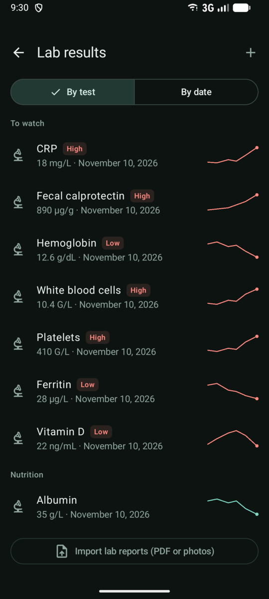

# IBD Journal

**English** · [Français](docs/i18n/README.fr.md) · [Deutsch](docs/i18n/README.de.md) · [Español](docs/i18n/README.es.md) · [Italiano](docs/i18n/README.it.md) · [Português](docs/i18n/README.pt.md)

An Android diary for people living with Crohn's disease or ulcerative colitis. Log stools and symptoms in a few taps, follow your treatments and lab results, prepare your exams, and bring a clear report to your doctor.

Your health data stays on your phone.

<p>
  
  
  
  
</p>

## Features

### Daily journal
- **Stools in two taps**: Bristol scale (type 0 = no stool that day), blood, mucus, pain and fatigue (0–5), urgency, night-time stools.
- **False urges**: urge to go without passing stool, common during flares. Logged separately, never counted as stools.
- **Meals**: photo or barcode scan (product details from Open Food Facts).
- **Evening reminder**: one notification to log stool type, pain and fatigue without opening the app. It stays until all three are answered.


### History and trends
- Monthly calendar colored by stool consistency.
- Stools per day, 30 days / 90 days / all history, days with each symptom compared with the previous period.
- **Doctor report (PDF)**: summary of the period, symptoms, treatments with adherence, latest blood panels with normal values.

### Care
- **Treatments**: standard IBD medications, reminders, "taken / missed" from the notification, adherence, refill alerts.
- **Blood and stool tests** scheduled with reminders.
- **Colonoscopy and rectosigmoidoscopy**: exam date, low-residue diet, bowel preparation doses (split dose), anesthesiologist appointment with a warning if it is missing or less than 48 h before the exam. A reminder for each step.
- **Lab results**: 43 common tests (CRP, fecal calprotectin, full blood count, iron panel, kidney, liver, lipids…), normal ranges from your lab or adult defaults (by sex), out-of-range values highlighted, charts and a table of blood panels.
- **Import lab reports** (PDF or photos, several at once): text recognition runs on the phone, values are converted to the app's units, and nothing is saved before you review it.

<p>
  
  
  
</p>

### Also
- Reminders as app notifications or as events in the phone calendar.
- Backup and restore (file export, optional Google Drive backup).
- Guided first launch, light and dark themes, several color palettes.
- Available in English, French, German, Spanish, Italian and Portuguese.

## Privacy

- The journal, treatments and lab results are stored in a local database on the phone. There is no account and no app server.
- Lab reports are read on the device (Google ML Kit text recognition); the documents are never uploaded. ML Kit may send anonymous usage statistics to Google.
- Network access is only used for barcode lookups (Open Food Facts) and, if you turn it on, the Google Drive backup.

## Build

Requirements: Android Studio (recent), JDK 17, Android SDK 37. The app runs on Android 8.0 (API 26) and later.

```bash
./gradlew :app:installDebug          # build and install on a connected device
./gradlew :shared:testAndroidHostTest # unit tests of the shared module
```

Release signing reads `keystore.properties` (not committed).

## Project structure

| Module | Content |
|---|---|
| `shared/` | Kotlin Multiplatform: data models, Room database, analysis, lab report parser, reminder and exam rules. Compiles for Android and iOS. |
| `app/` | Android app: Jetpack Compose (Material 3) UI, Hilt, notifications, calendar sync, PDF report, ML Kit OCR. |

## Disclaimer

IBD Journal is a personal tracking tool. It does not replace medical advice: always follow your doctor's instructions, especially for exam preparation and treatments.
