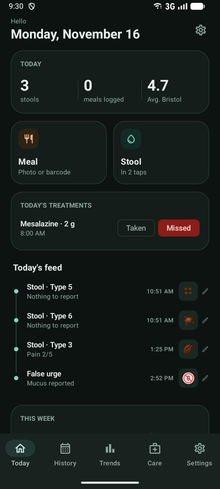
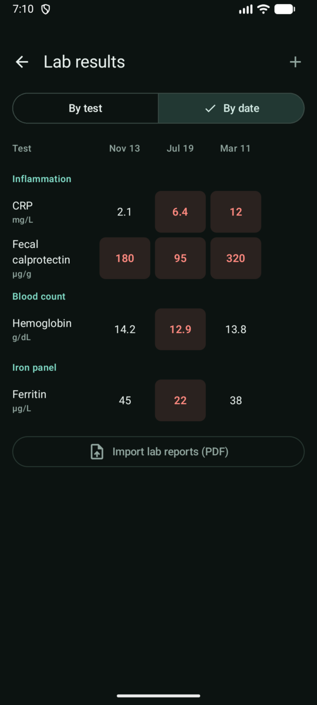

# IBD Journal

**English** · [Français](docs/i18n/README.fr.md) · [Deutsch](docs/i18n/README.de.md) · [Español](docs/i18n/README.es.md) · [Italiano](docs/i18n/README.it.md) · [Português](docs/i18n/README.pt.md)

An Android diary for people living with Crohn's disease or ulcerative colitis. Log stools and symptoms in a few taps, follow your treatments and lab results, prepare your exams, and bring a clear report to your doctor.

Your health data stays on your phone.

<p>
  
  
  
  
</p>

## Features

### Daily journal
- **Stools in two taps**: Bristol scale (type 0 = no stool that day), blood, mucus, pain and fatigue (0–5), urgency, night-time stools.
- **False urges**: urge to go without passing stool, common during flares. Logged separately, never counted as stools.
- **Meals**: photo or barcode scan (product details from Open Food Facts).
- **Evening reminder**: one notification to log stool type, pain and fatigue without opening the app. It stays until all three are answered.


### History and trends
- Monthly calendar colored by stool consistency.
- Stools per day, 30 days / 90 days / all history, days with each symptom compared with the previous period.
- **Doctor report (PDF)**: summary of the period, symptoms, treatments with adherence, latest blood panels with the lab's reference ranges.

### Care
- **Treatments**: standard IBD medications, reminders, "taken / missed" from the notification, adherence, refill alerts.
- **Blood and stool tests** scheduled with reminders.
- **Colonoscopy and rectosigmoidoscopy**: exam date, low-residue diet and bowel preparation doses as prescribed by your doctor, anesthesiologist appointment. A reminder for each step.
- **Lab results**: 47 common tests (CRP, fecal calprotectin, full blood count, iron panel, kidney, liver, lipids, biologic drug levels and anti-drug antibodies…), with the reference range printed by your lab, charts and a table of blood panels. The app provides no normal values of its own.
- **Import lab reports** (lab PDFs, several at once): the text of the PDF is read on the phone, values are converted to the app's units, and nothing is saved before you review it. Scanned documents are not supported.
- **Body weight**: weight entries with their date and a weight curve over 6 months, 1 year or the whole history.
- **Flares**: start and end dates, treatment, hospitalization. Flare days are marked on the calendar, the day screen and the stool chart, and an ongoing flare shows on the Today screen.
- **Vaccinations**: vaccines with date and next due date, with an optional reminder a week before and on the day.
- **Steroid courses**: dose steps, today's dose and cumulative dose.
- **Meals and symptoms**: foods eaten before liquid stools, blood or pain more often than usual, shown as an observation, not a cause.
- **Emergency**: a full-screen "I urgently need a toilet" card and an emergency sheet (diagnosis, treatments, allergies, doctor, contact), optionally readable from the lock screen.
- **Other symptoms**: joint pain, skin, eyes, mouth ulcers and fever noted per day, in the report for your doctor.
- **Questions for the doctor** and **appointments**: a list of what to ask, included in the report; appointments by kind of doctor with reminders the evening before and two hours before.

<p>
  
  
  
</p>

### Also
- Reminders as app notifications or as events in the phone calendar.
- Password-encrypted backup and restore to a file you keep yourself, with a monthly reminder; CSV export (spreadsheet) in a password-protected AES-256 ZIP archive.
- **PIN lock and local encryption**: a PIN (4 to 8 digits) is chosen at first launch, or right after updating. The journal database (SQLCipher) and meal photos are encrypted with a random key that only the PIN, or optionally your fingerprint, can unlock. The app locks one minute after leaving the screen; wrong PINs trigger waiting times. A forgotten PIN cannot be recovered: the only way out is to erase the data and restore an encrypted backup.
- Home-screen widgets: an "add a stool" button, and the last 7 days (stool counts and blood marks only; readable without the PIN, placing it is your choice).
- Sleep, stress and mood (1 to 5) and menstrual period noted per day, compared with bad days in Trends and averaged in the report.
- Optional count of intakes left per treatment, counted down as doses are confirmed taken, with a low-stock notification.
- Travel pack (PDF in French, English, Spanish or German): medication to take along for your dates with a safety margin, a letter for your doctor to date, sign and stamp, and the urgent-need card.
- Optional weekly weigh-in reminder: type your weight in the notification itself.
- Guided first launch, light and dark themes, several color palettes.
- Available in English, French, German, Spanish, Italian and Portuguese.

## Privacy

- The journal, treatments and lab results are stored in a local database on the phone. There is no account and no app server.
- No Google services and no trackers: lab reports are read from the PDF's own text (PdfBox-Android) and barcodes are scanned with ZXing, both entirely on the phone.
- Network access is only used for barcode lookups (Open Food Facts). No cloud backup: Android's automatic Google backup is turned off for the app.
- Exports are encrypted with a password you choose (AES-256-GCM, PBKDF2 key derivation).
- Local data is encrypted at rest with the PIN. Reminders and answers given from notifications keep working while the app is locked: a minimal copy of treatment, check-up and exam schedules and the pending answers are kept in files sealed by an Android Keystore key, readable only on this phone.
- Calendar sync is off by default. Turning it on writes treatment and exam names into the phone calendar, which may be synced with an online account; the app warns about this before enabling it.

## Build

Requirements: Android Studio (recent), JDK 17, Android SDK 37. The app runs on Android 8.0 (API 26) and later.

```bash
./gradlew :app:installDebug          # build and install on a connected device
./gradlew :shared:testAndroidHostTest # unit tests of the shared module
```

Release signing reads `keystore.properties` (not committed).

## Project structure

| Module | Content |
|---|---|
| `shared/` | Kotlin Multiplatform: data models, Room database, analysis, lab report parser, reminder and exam schedules. |
| `app/` | Android app: Jetpack Compose (Material 3) UI, Hilt, notifications, calendar sync, PDF report, PDF text extraction (PdfBox-Android), barcode scanning (ZXing). |

## Disclaimer

IBD Journal is a personal journal. It records and displays what you enter; it does not interpret your results or suggest any medical decision, and it is not a medical device. It does not replace medical advice: always follow your doctor's instructions, especially for exam preparation and treatments.

AI tools were used to write the code and to create the Bristol scale icons.

## License

[GNU AGPL-3.0](LICENSE). You may use, study, modify and share the app; anyone who distributes a modified version, or offers it as an online service, must publish its source code under the same license.
