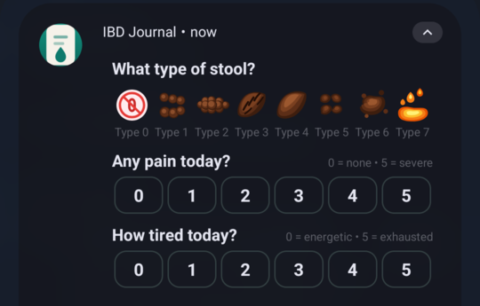

# IBD Journal

[English](../../README.md) · [Français](README.fr.md) · [Deutsch](README.de.md) · **Español** · [Italiano](README.it.md) · [Português](README.pt.md)

Un diario para Android para personas que viven con la enfermedad de Crohn o la colitis ulcerosa. Registra deposiciones y síntomas en unos pocos toques, sigue tus tratamientos y resultados de laboratorio, prepara tus exámenes y lleva un informe claro a tu médico.

Tus datos de salud permanecen en tu teléfono.

<p>
  
  
  
  
</p>

## Funciones

### Registro diario
- **Deposiciones en dos toques**: escala de Bristol (tipo 0 = ninguna deposición ese día), sangre, moco, dolor y fatiga (0–5), urgencia, deposiciones nocturnas.
- **Falsa urgencia**: ganas de ir al baño sin evacuar, frecuentes durante los brotes. Se registran por separado y nunca se cuentan como deposiciones.
- **Comidas**: foto o escaneo de código de barras (datos del producto de Open Food Facts).
- **Recordatorio nocturno**: una notificación para registrar el tipo de deposición, el dolor y la fatiga sin abrir la app. Permanece hasta que se respondan las tres cosas.



### Historial y tendencias
- Calendario mensual coloreado según la consistencia de las deposiciones.
- Deposiciones por día, 30 días / 90 días / todo el historial, y días con cada síntoma comparados con el periodo anterior.
- **Informe para el médico (PDF)**: resumen del periodo, síntomas, tratamientos con adherencia, últimos análisis de sangre con valores normales.

### Cuidados
- **Tratamientos**: medicamentos habituales para la EII, recordatorios, «tomado / olvidado» desde la notificación, adherencia, alertas de reposición.
- **Análisis de sangre y de heces** programados con recordatorios.
- **Colonoscopia y rectosigmoidoscopia**: fecha del examen, dieta sin residuos, dosis de preparación intestinal (pauta fraccionada), consulta de anestesia con aviso si falta o si es menos de 48 h antes del examen. Un recordatorio para cada paso.
- **Resultados de laboratorio**: 43 pruebas comunes (PCR, calprotectina fecal, hemograma, perfil de hierro, riñón, hígado, lípidos…), rangos normales de tu laboratorio o valores adultos por defecto (según el sexo), valores fuera de rango destacados, gráficos y una tabla de análisis de sangre.
- **Importar informes de laboratorio** (PDF o fotos, varios a la vez): el reconocimiento de texto se realiza en el teléfono, los valores se convierten a las unidades de la app y no se guarda nada hasta que lo revises.

<p>
  
  
  
</p>

### Además
- Recordatorios como notificaciones de la app o como eventos en el calendario del teléfono.
- Copia de seguridad y restauración (exportación a archivo, copia opcional en Google Drive).
- Primer inicio guiado, temas claro y oscuro, varias paletas de colores.
- Disponible en inglés, francés, alemán, español, italiano y portugués.

## Privacidad

- El diario, los tratamientos y los resultados de laboratorio se guardan en una base de datos local en el teléfono. No hay cuenta ni servidor de la app.
- Los informes de laboratorio se leen en el dispositivo (reconocimiento de texto de Google ML Kit); los documentos nunca se suben. ML Kit puede enviar estadísticas de uso anónimas a Google.
- El acceso a la red solo se usa para consultar códigos de barras (Open Food Facts) y, si lo activas, para la copia de seguridad en Google Drive.

## Compilación

Requisitos: Android Studio (reciente), JDK 17, Android SDK 37. La app funciona en Android 8.0 (API 26) y versiones posteriores.

```bash
./gradlew :app:installDebug          # compilar e instalar en un dispositivo conectado
./gradlew :shared:testAndroidHostTest # pruebas unitarias del módulo shared
```

La firma de la versión de publicación lee `keystore.properties` (no incluido en el repositorio).

## Estructura del proyecto

| Módulo | Contenido |
|---|---|
| `shared/` | Kotlin Multiplatform: modelos de datos, base de datos Room, análisis, analizador de informes de laboratorio, reglas de recordatorios y exámenes. Compila para Android e iOS. |
| `app/` | App de Android: interfaz con Jetpack Compose (Material 3), Hilt, notificaciones, sincronización del calendario, informe PDF, OCR con ML Kit. |

## Aviso legal

IBD Journal es una herramienta personal de seguimiento. No sustituye al consejo médico: sigue siempre las indicaciones de tu médico, especialmente para la preparación de exámenes y los tratamientos.
