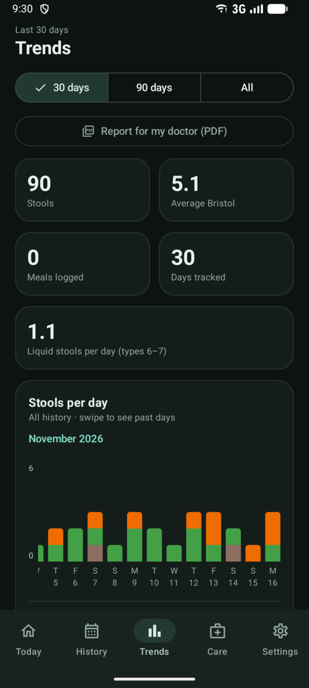

# IBD Journal

[English](../../README.md) · [Français](README.fr.md) · [Deutsch](README.de.md) · **Español** · [Italiano](README.it.md) · [Português](README.pt.md)

Un diario para Android para personas que viven con la enfermedad de Crohn o la colitis ulcerosa. Registra deposiciones y síntomas en unos pocos toques, sigue tus tratamientos y resultados de laboratorio, prepara tus exámenes y lleva un informe claro a tu médico.

Tus datos de salud permanecen en tu teléfono.

<p>
  
  
  
  
</p>

## Funciones

### Registro diario
- **Deposiciones en dos toques**: escala de Bristol (tipo 0 = ninguna deposición ese día), sangre, moco, dolor y fatiga (0–5), urgencia, deposiciones nocturnas.
- **Falsa urgencia**: ganas de ir al baño sin evacuar, frecuentes durante los brotes. Se registran por separado y nunca se cuentan como deposiciones.
- **Comidas**: foto o escaneo de código de barras (datos del producto de Open Food Facts).
- **Recordatorio nocturno**: una notificación para registrar el tipo de deposición, el dolor y la fatiga sin abrir la app. Permanece hasta que se respondan las tres cosas.


### Historial y tendencias
- Calendario mensual coloreado según la consistencia de las deposiciones.
- Deposiciones por día, 30 días / 90 días / todo el historial, y días con cada síntoma comparados con el periodo anterior.
- **Informe para el médico (PDF)**: resumen del periodo, síntomas, tratamientos con adherencia, últimos análisis de sangre con los rangos de referencia del laboratorio.

### Cuidados
- **Tratamientos**: medicamentos habituales para la EII, recordatorios, «tomado / olvidado» desde la notificación, adherencia, alertas de reposición.
- **Análisis de sangre y de heces** programados con recordatorios.
- **Colonoscopia y rectosigmoidoscopia**: fecha del examen, dieta sin residuos y dosis de preparación intestinal según indique tu médico, consulta de anestesia. Un recordatorio para cada paso.
- **Resultados de laboratorio**: 43 pruebas comunes (PCR, calprotectina fecal, hemograma, perfil de hierro, riñón, hígado, lípidos…), con el rango de referencia que indica tu laboratorio, gráficos y una tabla de análisis de sangre. La app no ofrece valores normales propios.
- **Importar informes de laboratorio** (PDF del laboratorio, varios a la vez): el texto del PDF se lee en el teléfono, los valores se convierten a las unidades de la app y no se guarda nada hasta que lo revises. No se admiten documentos escaneados.

<p>
  
  
  
</p>

### Además
- Recordatorios como notificaciones de la app o como eventos en el calendario del teléfono.
- Copia de seguridad y restauración cifrada con contraseña, en un archivo que guardas tú.
- Primer inicio guiado, temas claro y oscuro, varias paletas de colores.
- Disponible en inglés, francés, alemán, español, italiano y portugués.

## Privacidad

- El diario, los tratamientos y los resultados de laboratorio se guardan en una base de datos local en el teléfono. No hay cuenta ni servidor de la app.
- No hay servicios de Google ni rastreadores: los informes de laboratorio se leen del propio texto del PDF (PdfBox-Android) y los códigos de barras se escanean con ZXing, todo en el teléfono.
- El acceso a la red solo se usa para consultar códigos de barras (Open Food Facts). Sin copia en la nube: la copia de seguridad automática de Google de Android está desactivada para la app.
- Las exportaciones se cifran con una contraseña que tú eliges (AES-256-GCM, derivación de clave con PBKDF2).
- La sincronización del calendario está desactivada por defecto. Al activarla se escriben nombres de tratamientos y exámenes en el calendario del teléfono, que puede sincronizarse con una cuenta en línea; la app lo advierte antes de activarla.

## Compilación

Requisitos: Android Studio (reciente), JDK 17, Android SDK 37. La app funciona en Android 8.0 (API 26) y versiones posteriores.

```bash
./gradlew :app:installDebug          # compilar e instalar en un dispositivo conectado
./gradlew :shared:testAndroidHostTest # pruebas unitarias del módulo shared
```

La firma de la versión de publicación lee `keystore.properties` (no incluido en el repositorio).

## Estructura del proyecto

| Módulo | Contenido |
|---|---|
| `shared/` | Kotlin Multiplatform: modelos de datos, base de datos Room, análisis, analizador de informes de laboratorio, calendarios de recordatorios y exámenes. Compila para Android e iOS. |
| `app/` | App de Android: interfaz con Jetpack Compose (Material 3), Hilt, notificaciones, sincronización del calendario, informe PDF, extracción de texto de PDF (PdfBox-Android), escaneo de códigos de barras (ZXing). |

## Aviso legal

IBD Journal es un diario personal. Registra y muestra lo que introduces; no interpreta tus resultados ni sugiere ninguna decisión médica, y no es un producto sanitario. No sustituye al consejo médico: sigue siempre las indicaciones de tu médico, especialmente para la preparación de exámenes y los tratamientos.

Se han utilizado herramientas de IA para escribir el código y crear los iconos de la escala de Bristol.

## Licencia

[GNU AGPL-3.0](../../LICENSE). Puedes usar, estudiar, modificar y compartir la app; quien distribuya una versión modificada, o la ofrezca como servicio en línea, debe publicar su código fuente bajo la misma licencia.
