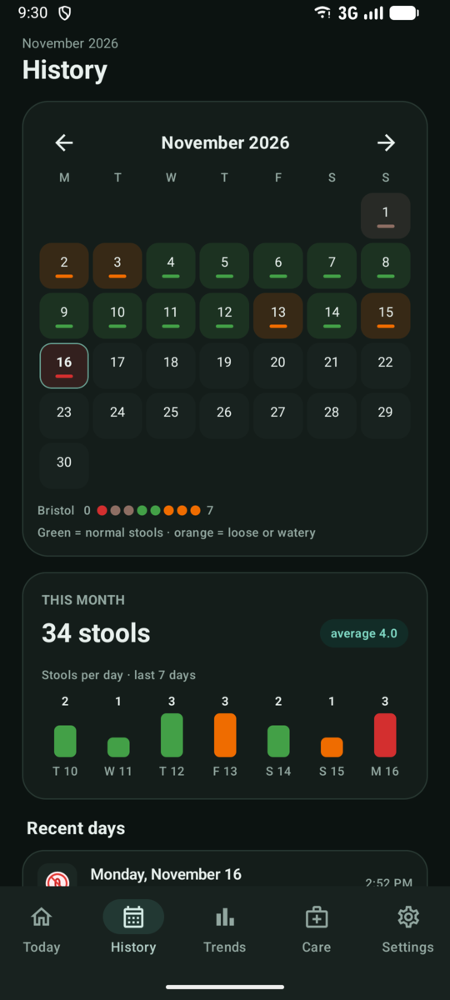
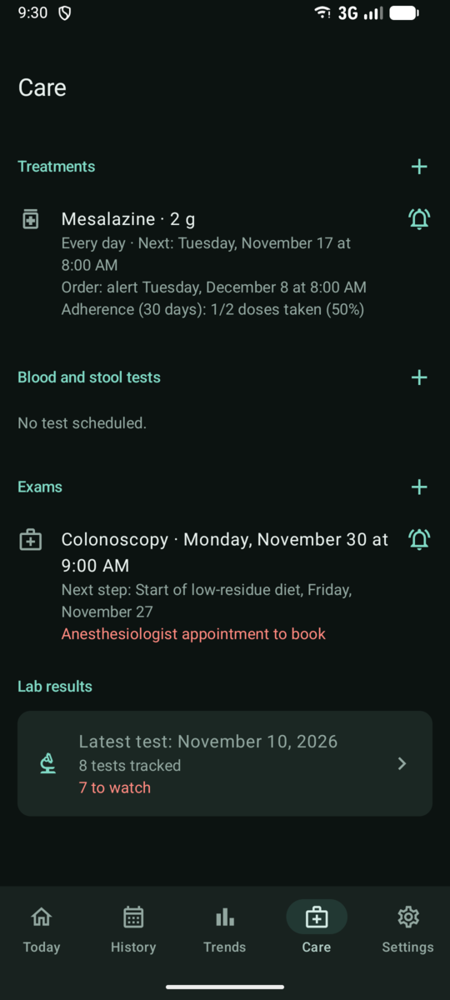

# IBD Journal

[English](../../README.md) · [Français](README.fr.md) · [Deutsch](README.de.md) · [Español](README.es.md) · [Italiano](README.it.md) · **Português**

Um diário Android para pessoas que vivem com doença de Crohn ou retocolite ulcerativa. Registre evacuações e sintomas em poucos toques, acompanhe seus tratamentos e resultados de exames, prepare seus exames e leve um relatório claro para o seu médico.

Os seus dados de saúde ficam no seu celular.

<p>
  
  
  
  
</p>

## Funcionalidades

### Diário diário
- **Evacuações em dois toques**: escala de Bristol (tipo 0 = nenhuma evacuação naquele dia), sangue, muco, dor e cansaço (0–5), urgência, evacuações noturnas.
- **Falsa vontade**: vontade de evacuar sem eliminar fezes, comum durante crises. Registrada separadamente e nunca contada como evacuação.
- **Refeições**: foto ou leitura de código de barras (dados do produto pelo Open Food Facts).
- **Lembrete noturno**: uma notificação para registrar o tipo de evacuação, a dor e o cansaço sem abrir o aplicativo. Ela permanece até que as três perguntas sejam respondidas.


### Histórico e tendências
- Calendário mensal colorido pela consistência das fezes.
- Evacuações por dia, 30 dias / 90 dias / todo o histórico, e dias com cada sintoma comparados ao período anterior.
- **Relatório para o médico (PDF)**: resumo do período, sintomas, tratamentos com adesão e últimos exames de sangue com valores normais.

### Cuidados
- **Tratamentos**: medicamentos usuais para DII, lembretes, "tomado / esquecido" pela notificação, adesão e alertas de reposição.
- **Exames de sangue e de fezes** agendados com lembretes.
- **Colonoscopia e retossigmoidoscopia**: data do exame, dieta sem resíduos, doses do preparo intestinal (dose fracionada), consulta de anestesia com aviso se estiver faltando ou se faltarem menos de 48 h para o exame. Um lembrete para cada etapa.
- **Resultados de exames**: 43 exames comuns (PCR, calprotectina fecal, hemograma, ferro, rins, fígado, lipídios…), valores de referência do seu laboratório ou padrões para adultos (por sexo), valores fora da faixa destacados, gráficos e uma tabela dos exames de sangue.
- **Importação de laudos** (PDF ou fotos, vários de uma vez): o reconhecimento de texto roda no celular, os valores são convertidos para as unidades do aplicativo, e nada é salvo antes da sua revisão.

<p>
  
  
  
</p>

### Também
- Lembretes como notificações do aplicativo ou como eventos no calendário do celular.
- Backup e restauração (exportação de arquivo, backup opcional no Google Drive).
- Primeira abertura guiada, temas claro e escuro, várias paletas de cores.
- Disponível em inglês, francês, alemão, espanhol, italiano e português.

## Privacidade

- O diário, os tratamentos e os resultados de exames são armazenados em um banco de dados local no celular. Não há conta nem servidor do aplicativo.
- Os laudos são lidos no próprio dispositivo (reconhecimento de texto do Google ML Kit); os documentos nunca são enviados. O ML Kit pode enviar estatísticas anônimas de uso ao Google.
- O acesso à rede é usado apenas para consultas de código de barras (Open Food Facts) e, se você ativar, para o backup no Google Drive.

## Compilação

Requisitos: Android Studio (versão recente), JDK 17, Android SDK 37. O aplicativo roda no Android 8.0 (API 26) e superiores.

```bash
./gradlew :app:installDebug          # compila e instala em um dispositivo conectado
./gradlew :shared:testAndroidHostTest # testes unitários do módulo shared
```

A assinatura de release lê `keystore.properties` (não versionado).

## Estrutura do projeto

| Módulo | Conteúdo |
|---|---|
| `shared/` | Kotlin Multiplatform: modelos de dados, banco de dados Room, análises, leitor de laudos, regras de lembretes e exames. Compila para Android e iOS. |
| `app/` | Aplicativo Android: interface Jetpack Compose (Material 3), Hilt, notificações, sincronização de calendário, relatório em PDF, OCR com ML Kit. |

## Aviso legal

IBD Journal é uma ferramenta pessoal de acompanhamento. Ele não substitui a orientação médica: siga sempre as instruções do seu médico, especialmente para o preparo dos exames e para os tratamentos.
